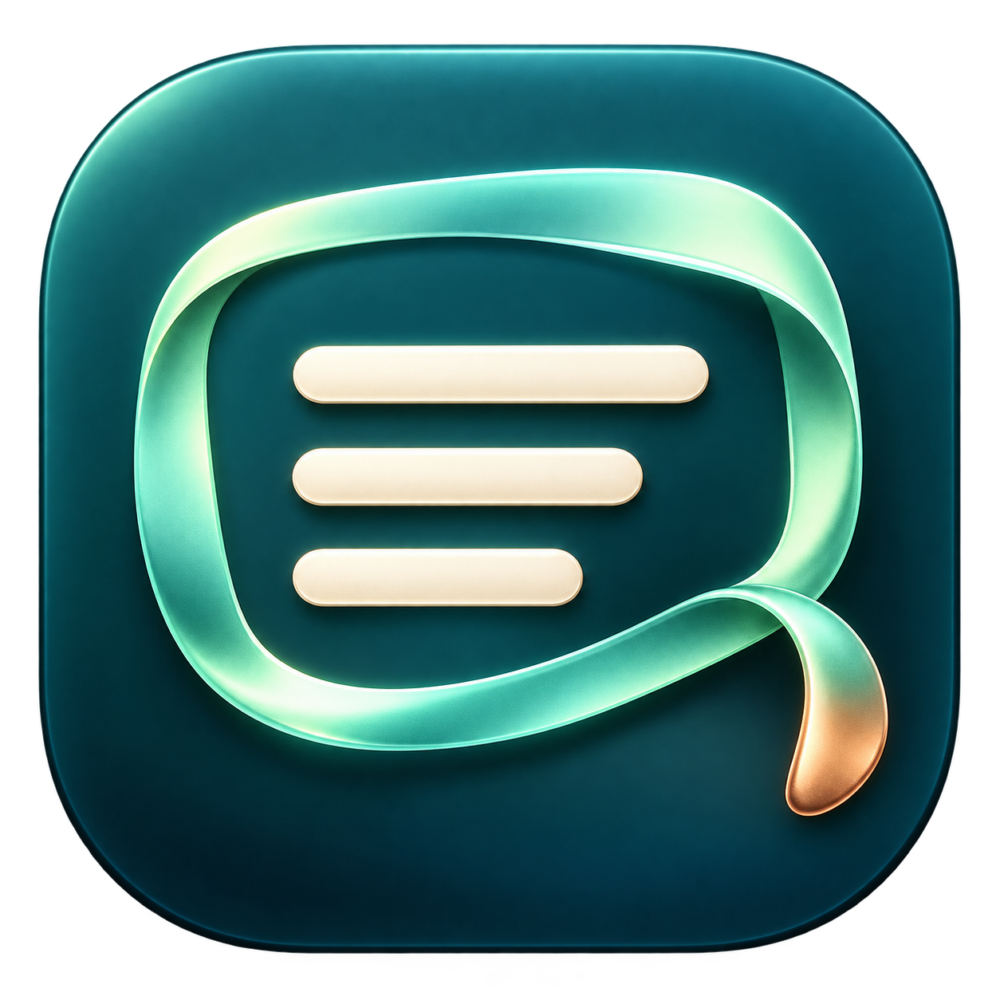

<p align="center">
  
</p>

<h1 align="center">LassoText</h1>

<p align="center">
  <strong>Select a rectangle. Copy its text. Get on with it.</strong><br>
  Offline screen-to-text for macOS · <kbd>⌘</kbd> <kbd>⇧</kbd> <kbd>2</kbd>
</p>

<p align="center">
  <a href="LICENSE"></a>
  
</p>

A small, native macOS menu bar app inspired by the screen-to-text workflow of
TextSniper. Press **Command + Shift + 2** (the same default as TextSniper), drag around text on any display, and
paste it wherever you need it. Escape or right-click cancels.

Built with Swift, AppKit, ScreenCaptureKit, and Apple Vision. MIT licensed.
No third-party packages, accounts, network requests, analytics, or saved captures.
This is an independent project, unaffiliated with TextSniper.

## Build and run

Requires macOS 15 or later and Xcode 16 or later (or its command line tools).

```sh
./scripts/build.sh
open dist/LassoText.app
```

Move the app to `/Applications` before granting permission if you intend to keep
it installed there. On first capture, allow **LassoText** in System Settings →
Privacy & Security → Screen & System Audio Recording. Reopen the app if macOS
requests it. Accessibility and Input Monitoring permissions are not required.

The menu bar uses a monochrome lasso mark that follows the system appearance.
Click it to toggle a nonmodal panel with **Capture Text**, **Settings**, and
**Quit**. Click again, click outside, or press Escape to dismiss it. Opening the
panel does not capture or freeze your screen. Settings
include recognition language, line breaks, copy sound, and opt-in start at login.
If another app owns Command + Shift + 2, LassoText shows the registration error;
capture remains available from its menu.

## Languages

Automatic mode enables every recognition language reported by Apple Vision on
the current Mac, prioritizing English, Romanian, and Danish. The language picker
lists the actual supported languages, rather than advertising a fixed list that
might not exist on an older system. Choose a specific language when automatic
recognition confuses similar words.

On the development Mac (macOS 27.0.1), Vision reports 33 language identifiers,
including English, Romanian, Danish, Arabic, Chinese, Czech, Dutch, Finnish,
French, German, Hindi, Indonesian, Italian, Japanese, Korean, Malay, Marathi,
Norwegian, Polish, Portuguese, Russian, Spanish, Swedish, Thai, Turkish,
Ukrainian, and Vietnamese, including regional/script variants.

Language coverage depends on macOS. **English, Romanian, and Danish are tested
with their diacritics in both explicit and automatic mode.** Recognition is not
perfect; small text, unusual fonts, complex columns, or low contrast can reduce
accuracy. Vision's reading order is preserved. Line breaks can be flattened.

## Capture behavior and privacy

- All connected displays are frozen before selection. Drag on one display at a
  time; a selection is constrained to the display where the drag starts.
- Full-screen apps and Retina displays are supported by the overlay and pixel
  conversion. Disconnecting a display cancels an active selection.
- Screen images exist only in memory for capture and recognition. Nothing is
  written to disk or sent over the network. The recognized text goes to the
  system clipboard, which other apps and clipboard managers may read.
- Cancelling, empty selections, and failed recognition leave the clipboard alone.
  Errors appear visibly. A successful copy changes the menu icon and optionally
  plays a sound.
- Protected video or other content macOS refuses to capture cannot be recognized.

## Development

```sh
swift build -Xswiftc -warnings-as-errors
swift test
./scripts/build.sh release
```

`LassoCore` owns OCR and point-to-pixel geometry. The app target owns the global
hotkey, per-display capture, selection windows, preferences, and clipboard.
`LassoMenuBar` owns the nonmodal status panel and native template icon.
Tests exercise real Vision recognition of rendered English, Romanian, and Danish
text on light and dark backgrounds, line breaks, blank input, unsupported
languages, Retina scaling, clipping, and reverse drags. The primary-language test
requires an OS whose Vision engine supports those languages. CI compiles all
tests and runs the deterministic geometry suite. Run the complete `swift test`
suite locally to verify OCR accuracy: the initial hosted macOS runner exceeded
its 15-minute timeout running Vision recognition. The local AppKit panel tests
exercise a real popover in a window host, including repeat clicks, outside event
delivery, and Escape; they require a graphical macOS session.

The packaging script creates a complete `.app`, generates its vector-derived
icon, and signs it locally. Set `CODE_SIGN_IDENTITY` to a Developer ID identity
for distribution signing. Local ad-hoc builds are **not notarized**. Public
binary distribution requires Developer ID signing and Apple notarization; the
source can be built locally without either. Rebuilding an ad-hoc signed app can
require granting Screen Recording permission again. If the switch is already on
but capture still reports access denied, remove only LassoText from that privacy
list, add the current `/Applications/LassoText.app` again, and choose **Quit &
Reopen**. Replacing the stale entry resolved this on the development Mac; simply
toggling it did not.

See [CONTRIBUTING.md](CONTRIBUTING.md) for contribution checks. The social
preview and its source live in [docs/branding](docs/branding/README.md).
